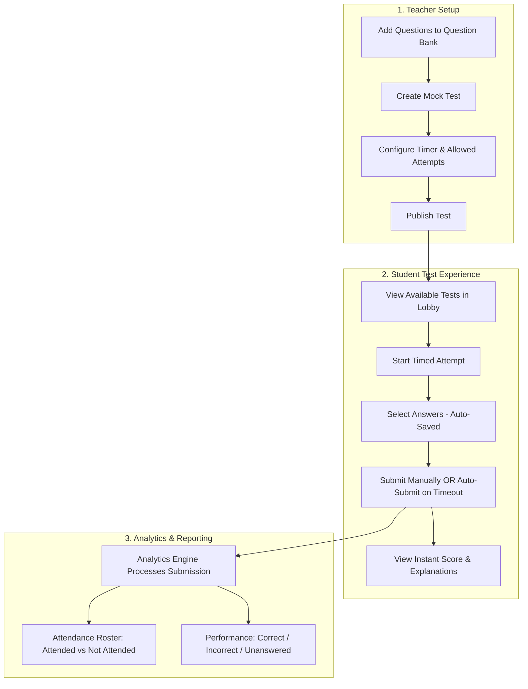

## 1. Document Control & Executive Summary
### 1.1 Business Context & Purpose
Educational institutes need to assess student readiness through timed, standardized mock exams. Manual paper-based tests or unstructured Google Forms fail to deliver:
* Real-time automated grading.
* Granular attempt tracking across multiple sittings.
* Instant visibility for teachers into **which students did not appear**.
* Deep question-level analytics (which questions confused students the most).
This document details the functional specifications, business rules, user workflows, data contracts, and non-functional requirements (NFRs) necessary for developers to build an enterprise-grade **Online Mock Test Application**.
---
## 2. User Roles & Access Control Matrix (RBAC)
The system enforces strict Role-Based Access Control (RBAC). A user cannot switch roles without administrative privilege re-assignment.
| Feature / Capability | Teacher | Student | Guest / Anonymous |
| :--- | :---: | :---: | :---: |
| Authenticate via Credentials | Allowed | Allowed | Denied |
| Create, Edit, or Delete Questions in Question Bank | Allowed | Denied | Denied |
| Bulk Upload Questions via CSV / Excel | Allowed | Denied | Denied |
| Create, Configure, and Publish Mock Tests | Allowed | Denied | Denied |
| Take / Attempt a Published Mock Test | Denied | Allowed | Denied |
| View Immediate Score & Explanations Post-Test | Denied | Allowed (Own Score Only) | Denied |
| View Personal Past Attempts History | Denied | Allowed (Own History Only) | Denied |
| View Aggregate Class Analytics Dashboard | Allowed | Denied | Denied |
| View List of "Not Attended" Students | Allowed | Denied | Denied |
| View Individual Student Attempt Breakdown | Allowed | Denied | Denied |
---
## 3. High-Level System Workflow

### End-to-End Flow Summary
1. **Preparation:** Teacher adds MCQs to the Question Bank, selects questions, sets duration and attempt limits, and publishes the test.
2. **Execution:** Student enters the test, takes the exam against a live server countdown timer with continuous auto-saving.
3. **Completion:** Test submits on student confirmation or automatically when the timer reaches `00:00:00`.
4. **Immediate Feedback:** Student immediately

---
## 4. Detailed Functional Requirements (Module by Module)
### Module 1: Question Bank Management (Teacher Only)
#### 1.1 Objective
Provide a centralized repository where teachers curate multiple-choice questions (MCQs) before bundling them into tests.
#### 1.2 Specifications & Business Rules
* **Question Schema:**
  * **Question Text:** Rich text (supports text, mathematical symbols, or code snippets).
  * **Options:** Exactly **4 choices** (Option A, Option B, Option C, Option D).
  * **Correct Answer:** Exactly one option must be marked as `Correct`.
  * **Explanation / Solution:** Optional text explaining why the answer is correct (revealed to students post-submission).
  * **Metadata:** Subject / Topic tag (e.g., `Physics > Thermodynamics`), Difficulty Level (`Easy`, `Medium`, `Hard`).
* **Creation Channels:**
  1. **Single Entry:** Form-based UI to type the question, 4 choices, and select the radio button for the correct answer.
  2. **Bulk Upload:** CSV / XLSX import. The system must validate headers (`question_text, option_a, option_b, option_c, option_d, correct_option, explanation`) and reject corrupt rows with specific line-number error messages before committing to the database.
---
### Module 2: Test Creation & Configuration Engine (Teacher Only)
#### 2.1 Objective
Allow teachers to assemble questions into a formal test and define assessment constraints.
#### 2.2 Functional Steps
1. **Basic Info:** Teacher inputs `Test Title`, `Subject`, and `Description`.
2. **Question Selection:**
   * Teacher is presented with the Question Bank catalog.
   * Can search/filter by Topic, Subject, or Difficulty.
   * Teacher selects questions using checkboxes. A running tally displays: `Total Selected: N Questions`.
3. **Configurable Test Settings:**
   * **Time Limit:** Duration in minutes (e.g., `30 mins`, `60 mins`).
   * **Allowed Attempts:** Positive integer (e.g., `1`, `2`, `3`, or `Unlimited`).
   * **Assigned Batch / Class:** Group of students eligible to take this test.
   * **Status:** `Draft` (hidden from students) or `Published` (immediately visible to students).
---
### Module 3: Student Exam Execution Engine (Student Only)
#### 3.1 Objective
Provide a distraction-free, reliable, real-time testing environment.
#### 3.2 Functional Specifications
* **Pre-Exam Screen (Lobby):**
  * Displays: Test Title, Instructions, Total Questions, Time Limit, and Remaining Allowed Attempts (e.g., *"Attempt 1 of 3 used"*).
  * If a student has reached the maximum allowed attempts, the **"Start Test"** button is disabled with the warning: *"You have exhausted all allowed attempts for this test."*
* **Active Exam Interface:**
  * **Countdown Timer:** Prominently visible sticky timer at the top.
    * When `Time Remaining <= 5 minutes`, the timer pulses yellow/amber.
    * When `Time Remaining <= 1 minute`, the timer pulses red.
  * **Question Palette / Navigation Drawer:**
    * Grid showing numbers 1 to N.
    * Color-coded status for each question:
      * **Grey:** Not Visited.
      * **Red / Amber:** Visited, but Unanswered.
      * **Green:** Answered.
      * **Purple:** Marked for Review (allows student to bookmark a question).
  * **Draft Auto-Saving:** Every time a student selects or changes a radio button, the selection is instantly persisted to the backend session. If the user accidentally refreshes or loses connection, their selected options are preserved.
* **Submission Logic:**
  1. **Manual Submission:** Student clicks "Submit Test". A modal displays summary metrics: *"You answered 18 of 20 questions. 2 are unanswered. Are you sure you want to finish?"*
  2. **Auto-Submission (Timer Expiry):** When the countdown reaches `00:00:00`, the system automatically freezes all inputs, captures the latest state, and submits without requiring student confirmation.
---
### Module 4: Instant Evaluation & Feedback (Student Only)
#### 4.1 Objective
Immediately calculate and display test performance upon submission.
#### 4.2 Scoring Engine
* **Evaluation Rules:**
  * Score = Total count of correct answers × 1.0.
  * Percentage = (Score / Total Questions) × 100.
* **Immediate Post-Submission Result Screen:**
  * **Scorecard:** Total Score (e.g., `16 / 20`), Accuracy %, Time Spent.
  * **Question-by-Question Review:**
    * The student's chosen option.
    * The correct option (highlighted in green).
    * If the student's answer was incorrect, their selection is highlighted in red.
    * If left unanswered, labeled as `Unanswered`.
    * Official explanation note displayed below each question.
---
### Module 5: Student Attempt History Portal (Student Only)
#### 5.1 Objective
Empower students to monitor their progress and review past performance over time.
#### 5.2 Functional Specifications
* In the student's personal dashboard, every test shows an **Attempt Ledger**:
  * `Attempt #` (1, 2, 3...)
  * `Date & Timestamp`
  * `Score Achieved`
  * `Time Taken`
  * `Action Link`: "Review Answers" (re-opens the read-only post-submission review for that specific historical attempt).
---
### Module 6: Teacher Analytics & Test Performance Dashboard (Teacher Only)
#### 6.1 Objective
Provide deep educational insights into class attendance and question efficacy.
#### 6.2 Key Dashboard Views
##### View A: Test Attendance Summary
* **Total Assigned Students:** Total enrolled students in the class.
* **Attended Count:** Count of unique students who submitted at least 1 attempt.
* **Not Attended Count:** Count of eligible students with 0 attempts.
* **Actionable "Not Attended" Roster:**
  * A table listing: Student Name, Roll Number, Email Address.
  * Quick-action button: *"Export Absentee List (CSV)"* or *"Send Reminder Notification"*.
##### View B: Aggregated Test Performance Metrics
For a selected test, the dashboard aggregates across all submissions:
1. **Total Questions Answered Correctly:** Sum of all correct answers across all student attempts.
2. **Total Questions Answered Incorrectly:** Sum of all wrong answers.
3. **Total Questions Left Unanswered:** Sum of questions skipped or unselected.
4. **Class Average Score:** Mean score across students.
5. **Score Distribution Chart:** Histogram of score brackets (e.g., `< 40%`, `40–70%`, `> 70%`).
##### View C: Question-Level Item Analysis (Diagnostic Matrix)
A table listing every question in the test with performance metrics:
| Q# | Question Snippet | % Correct | % Incorrect | % Skipped | Difficulty Assessment |
| :---: | :--- | :---: | :---: | :---: | :---: |
| Q1 | What is Newton's Second Law? | 85% | 10% | 5% | Low (Well Understood) |
| Q2 | Calculate the enthalpy change... | 22% | 68% | 10% | High (Needs Revision in Class) |
##### View D: Student-Wise Attempts Breakdown
* Expandable row per student showing:
  * Number of attempts made (e.g., `2 / 2`).
  * Best Score vs. Latest Score.
  * Link to inspect the student's exact submission sheet.
---
## 5. Conceptual Data Domain Model
Developers should design the database schema around the following core relational entities:
| Entity Name | Primary Fields | Relationships |
| :--- | :--- | :--- |
| **Users** | `id`, `name`, `email`, `role (TEACHER / STUDENT)`, `class_id` | 1:N with `Mock_Tests`, 1:N with `Test_Attempts` |
| **Question_Bank** | `id`, `question_text`, `option_a`, `option_b`, `option_c`, `option_d`, `correct_option`, `explanation`, `created_by` | M:N with `Mock_Tests` via `Test_Questions` |
| **Mock_Tests** | `id`, `title`, `duration_minutes`, `max_attempts`, `created_by`, `status (DRAFT / PUBLISHED)` | 1:N with `Test_Attempts`, 1:N with `Test_Questions` |
| **Test_Questions** | `id`, `test_id (FK)`, `question_id (FK)`, `question_order` | Junction table connecting tests and questions |
| **Test_Attempts** | `id`, `test_id (FK)`, `student_id (FK)`, `attempt_number`, `started_at`, `submitted_at`, `total_score`, `status` | 1:N with `Student_Answers` |
| **Student_Answers** | `id`, `attempt_id (FK)`, `question_id (FK)`, `selected_option`, `is_correct` | Records choices made per question per attempt |
---
## 6. Critical Business Rules & Edge Cases
| Scenario / Edge Case | Business Rule & System Reaction |
| :--- | :--- |
| **Network Loss / Tab Close During Test** | The backend stores the `started_at` timestamp. If a student closes their tab and reopens it after 10 minutes, the timer continues running from the server clock. Their previously selected answers are restored from the database. |
| **Submission After Timer Has Expired** | If a student's client device attempts to submit answers past the expiration timestamp + 10 seconds grace period, the server rejects late inputs and evaluates only whatever was saved prior to expiration. |
| **Attempt Limit Exhaustion** | If `max_attempts = 2`, and the student has 2 completed attempts in `TEST_ATTEMPTS`, any request to initiate a 3rd attempt returns an HTTP `403 Forbidden` error with the code `ATTEMPTS_EXHAUSTED`. |
| **Teacher Edits a Published Test** | Once at least one student has initiated an attempt on a test, the teacher cannot remove questions or alter the duration. Only title/description edits are permitted to maintain data consistency. |
| **Question Left Unanswered** | In `STUDENT_ANSWERS`, `selected_option` is recorded as `NULL`, `is_correct = false`. On the dashboard, it increments the `Unanswered` metric. |
---
## 7. Non-Functional Requirements (NFRs)
### 7.1 Performance & Scalability
* **Concurrent Exam Start:** The system must handle up to **500 students simultaneously clicking "Start Test"** within a 30-second window without database connection pool exhaustion or timeouts.
* **Auto-Save Latency:** Background saving of answer clicks must complete with an API response time of **< 200 ms**.
* **Instant Evaluation:** The calculation of scores and generation of the review screen must occur in **< 1.0 second** upon clicking Submit.
### 7.2 Integrity & Security
* **Tamper-Proof Answers:** The correct answers (`correct_option`) and explanations must **never** be sent to the student's browser during the active test session. Inspecting Network DevTools or HTML DOM must not reveal the answer key.
* **Server-Authoritative Clock:** The countdown timer must synchronize against the server time upon initialization to prevent students from modifying their system clock to gain extra time.
### 7.3 Usability & Device Support
* Fully responsive layout optimized for Desktop/Laptop screens (1366x768 and above) and Tablets (e.g., iPads / Chromebooks commonly used in schools).
---
## 8. QA Acceptance Criteria
### Scenario 1: Teacher Successfully Creates a Timed Test

Given a Teacher is logged into the platform
And there are at least 20 questions available in the Question Bank
When the Teacher selects 10 questions
And sets Duration to "45" minutes
And sets Allowed Attempts to "2"
And clicks "Publish Test"
Then the test status changes to "PUBLISHED"
And the test immediately appears on the Student dashboard.

### Scenario 2: Student Exceeds Allowed Attempts
Given a Student has already completed 2 attempts on a test where Max Attempts is "2"
When the Student visits the Test Lobby screen
Then the "Start Test" button is disabled
And an informative alert states: "You have used all 2 allowed attempts."

### Scenario 3: Auto-Submit on Timer Expiration

Given a Student is actively taking a mock test
And the countdown timer reaches "00:00:00"
When the time expires
Then the test interface automatically locks to prevent further selections
And the attempt is automatically submitted to the server
And the Student is redirected to the Score Summary screen.

### Scenario 4: Teacher Dashboard Correctly Reflects "Not Attended"
Given a class has 30 enrolled students
And a published test has been submitted by 18 students
When the Teacher opens the Test Analytics Dashboard
Then "Attended Count" displays "18"
And "Not Attended Count" displays "12"
And the "Not Attended" table lists exactly the 12 students who have 0 registered attempts.

